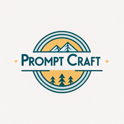
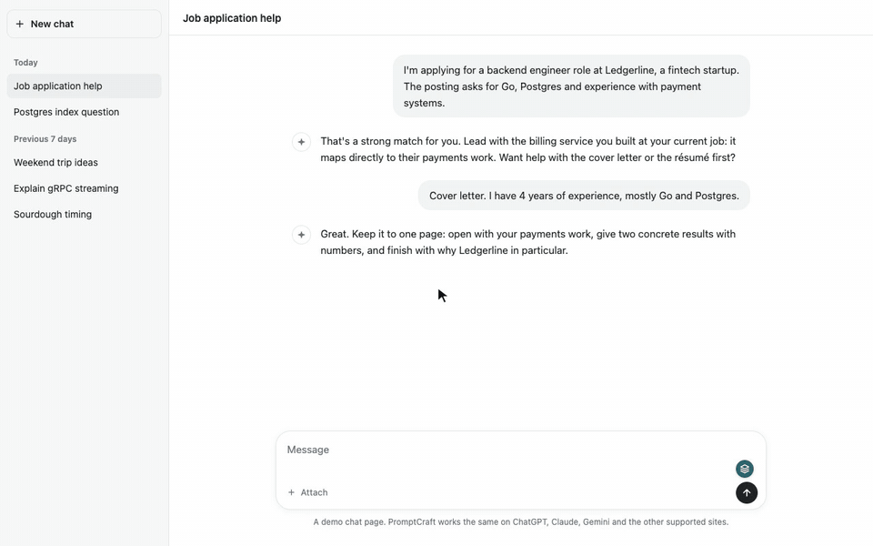
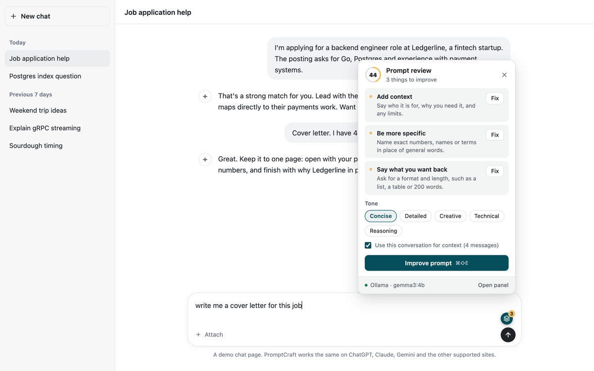
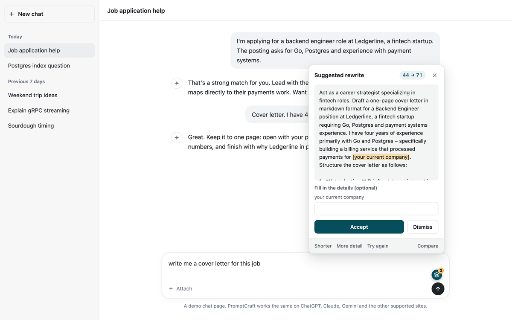
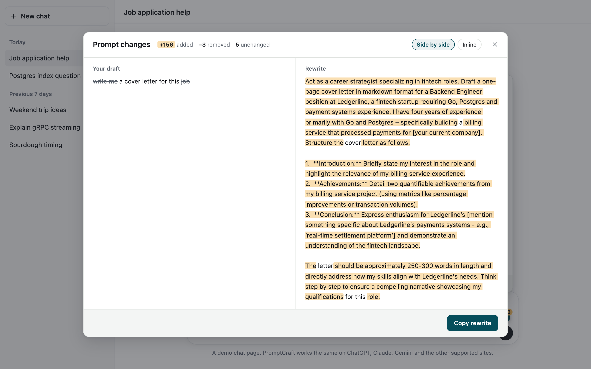
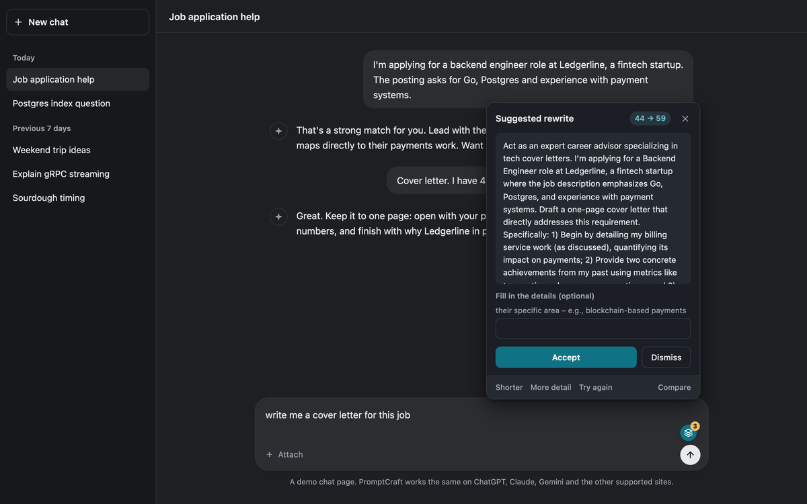
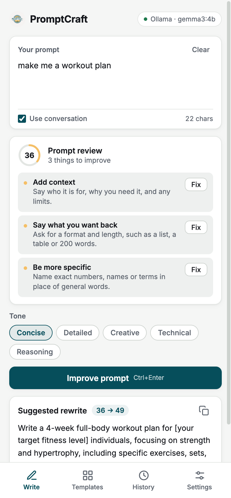
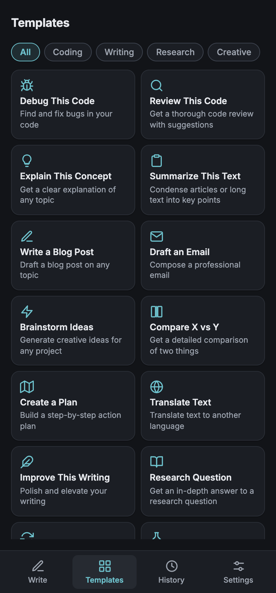

<div align="center">



# PromptCraft

**Bad prompts, bad answers. PromptCraft fixes that in one click.**

[](https://github.com/colingalbraith/PromptCraft/releases/latest)
[](https://github.com/colingalbraith/PromptCraft/actions/workflows/test.yml)
[](LICENSE)
[](https://github.com/colingalbraith/PromptCraft)

[Download](https://github.com/colingalbraith/PromptCraft/releases/latest) · [Website](https://getpromptcraft.vercel.app) · [Report a bug](https://github.com/colingalbraith/PromptCraft/issues) · [Contributing](CONTRIBUTING.md)

</div>

<p align="center">
  
</p>

PromptCraft is a free, open-source Chrome extension that reviews and rewrites your AI prompts where you type them. A small badge in the chat box scores your draft as you write. One click turns it into a clear, specific prompt that uses the conversation you are in, and your text only changes when you accept.

It works on ChatGPT, Claude, Gemini, DeepSeek, Perplexity, Grok, HuggingFace and OpenRouter, and on any other text field through the right-click menu. Bring your own API key, run a model locally with Ollama, or use the model built into your browser.

---

## Contents

- [Screenshots](#screenshots)
- [Install](#install)
- [Providers](#providers)
- [How it works](#how-it-works)
- [Features](#features)
- [Troubleshooting](#troubleshooting)
- [Privacy](#privacy)
- [Development](#development)
- [License](#license)

---

## Screenshots

<table>
  <tr>
    <td width="50%"></td>
    <td width="50%"></td>
  </tr>
  <tr>
    <td align="center"><b>Review as you type.</b> A score, the weakest spots with one-click fixes, and the tone.</td>
    <td align="center"><b>Suggest, then accept.</b> The rewrite builds on the conversation and leaves blanks for details only you know.</td>
  </tr>
  <tr>
    <td></td>
    <td></td>
  </tr>
  <tr>
    <td align="center"><b>Compare</b> the draft and the rewrite word by word.</td>
    <td align="center"><b>Follows the site's theme</b>, light or dark.</td>
  </tr>
</table>

<table>
  <tr>
    <td width="50%" align="center"></td>
    <td width="50%" align="center"></td>
  </tr>
  <tr>
    <td align="center"><b>Side panel</b> for writing, history and settings, beside any page.</td>
    <td align="center"><b>14 templates</b> for code, writing, research and planning.</td>
  </tr>
</table>

<sub>Shown on a demo chat page with a local model (Ollama, gemma3:4b).</sub>

---

## Install

1. Download the `promptcraft-<version>.zip` file from the [latest release](https://github.com/colingalbraith/PromptCraft/releases/latest) and unzip it.
2. Open `chrome://extensions`, turn on **Developer mode** (top right) and click **Load unpacked**.
3. Select the unzipped folder.
4. Click the PromptCraft icon in the toolbar. It opens in the side panel, where a short setup asks which model to use.

To run it from source instead, `git clone https://github.com/colingalbraith/PromptCraft.git` and load that folder in step 3.

---

## Providers

| Provider | Type | Models |
|---|---|---|
| **Built-in** | On-device | The model built into your browser (Gemini Nano in Chrome). Free, no key. Offered only where the browser can run it |
| **Google Gemini** | Cloud API | Gemini 3.5 Flash-Lite, 3.8 Flash, 3.1 Flash-Lite, 3.1 Pro |
| **OpenAI** | Cloud API | GPT-6 Luna, GPT-6.1 Sol, GPT-6 Astra |
| **Anthropic Claude** | Cloud API | Claude Opus 5.5, Sonnet 5.5, Haiku 5.5, Fable 5.1 |
| **Ollama** | Local | Any installed model, free |
| **Custom** | Any | Any OpenAI-compatible API: Groq, Together, OpenRouter, LM Studio, vLLM |

These lists are a starting point: **↻** next to the model picker in Settings loads the provider's current models, so new releases work without an extension update.

> **New to this?** If setup offers **Built-in**, pick it: there is nothing to configure. Chrome downloads the model once (a few GB) and needs roughly 22 GB of free disk space. Otherwise start with **Gemini**, which has a free tier with no credit card. [Get a key.](https://aistudio.google.com/app/apikey)
>
> **Using Ollama?** Let browser extensions reach it by setting `OLLAMA_ORIGINS=chrome-extension://*` and restarting Ollama.

---

## How it works

1. **Type your prompt.** The badge in the chat box counts what could be better.
2. **Click the badge** for the score, the weak spots and the tone, or press `Ctrl+Shift+E` (`⌘⇧E` on a Mac) to go straight to a rewrite.
3. **Improve prompt.** The rewrite streams into a card beside the box.
4. **Fill in any blanks**, details only you know.
5. **Accept**, or ask for *Shorter*, *More detail* or *Try again*. *Undo* puts your draft back.

Before the request, PromptCraft reviews the draft on your device (what it contains, what it asks for, where it is weak) and picks the conversation messages most relevant to it. It then sends one streaming request to your provider and strips any chatter the model adds, so only the prompt reaches your text box.

Outside the supported chat sites nothing is added to a page until you ask: click into a text field and use the shortcut or right-click → **Enhance with PromptCraft**. The shortcut can be changed at `chrome://extensions/shortcuts`.

---

## Features

| Feature | What it does |
|---|---|
| **Live review** | A 0-100 score and up to three weak spots as you type, each with a one-click *Fix*. Scored on your device; nothing is sent until you ask for a rewrite |
| **Context-aware** | Uses the recent conversation on the page, ranked by relevance, and tailors the prompt to the AI you are chatting with. One switch turns it off |
| **No invented details** | Where only you know the answer, the rewrite leaves a `[bracketed blank]` and offers a field for it |
| **Tones and presets** | Concise, Detailed, Creative, Technical and Reasoning, or your own. Built-in tones can be edited |
| **Templates** | 14 starting points: debug or review code, write an email or blog post, compare options, plan, translate and more |
| **History and usage** | Search, reuse and export past rewrites with before → after scores; see tokens and estimated cost per model |
| **Optional extra passes** | Deep analysis before rewriting, or a three-pass tone → structure → polish pipeline |
| **Works everywhere** | Right-click menu and keyboard shortcut on any site, and *Insert* from the side panel into the page |
| **Accessible** | Full keyboard support, labelled controls and visible focus; follows light and dark themes and reduced motion |

---

## Troubleshooting

| Problem | Fix |
|---|---|
| **Ollama refused the request (403)** | Ollama only accepts requests from browser extensions when allowed to. Set `OLLAMA_ORIGINS=chrome-extension://*` and restart Ollama. Setup and Settings check this when they connect |
| **Model not found** | In Settings, press **↻** next to the model picker to load the provider's current models |
| **"Built-in model is not responding"** | Chrome hasn't made its on-device model available yet, or it is turned off by policy. Try again later or pick another provider |
| **Custom endpoint can't be reached** | Chrome asks for access to that address when you save or test it; allow it. Local servers may also need CORS enabled |
| **`Ctrl+Shift+E` does nothing** | Another extension or the browser owns the shortcut. Rebind it at `chrome://extensions/shortcuts` |
| **"PromptCraft was updated. Reload this page"** | The extension was reloaded while the tab was open. Refresh the tab |

---

## Privacy

- **No servers, no tracking.** PromptCraft has no backend, analytics or accounts. Fonts are bundled, so the only network requests go to the provider you chose.
- **Your keys stay on your device**, are never synced, and cannot be read by web pages, including the chat sites it runs on.
- **Only what a rewrite needs is sent**: your draft and, when context is on, recent messages from the page, straight to your provider. With the built-in model or a local Ollama nothing leaves your computer.
- **Runs only where needed**: on the supported chat sites, and elsewhere only after you invoke it.

Read the full [privacy policy](https://getpromptcraft.vercel.app/privacy.html).

---

## Development

No build step and no dependencies: plain JavaScript, HTML and CSS, loaded unpacked as above.

```bash
node --test               # service worker tests (Node 22+); the live Ollama test skips itself without one
node scripts/package.js   # builds dist/promptcraft-<version>.zip for the Chrome Web Store
```

| File | Role |
|---|---|
| `background.js` | Service worker: providers, streaming, output cleanup, storage |
| `content.js` | The badge, cards and changes dialog on the page; reads the conversation |
| `input-parser.js` | On-device review: scoring, issues and input analysis |
| `constants.js` | Prompts, tones, templates, model lists and prices |
| `popup.html` · `popup.js` · `popup.css` | The side panel |
| `tests/` | Tests, with a fake `chrome` API and scripted provider responses |

Pull requests go to the `Development` branch; see the [contributing guide](CONTRIBUTING.md). Release notes are in the [changelog](CHANGELOG.md).

---

## License

MIT. See [LICENSE](LICENSE).

<div align="center">

Built by [Colin Galbraith](https://github.com/colingalbraith). If PromptCraft helps you, consider giving it a star.

</div>
